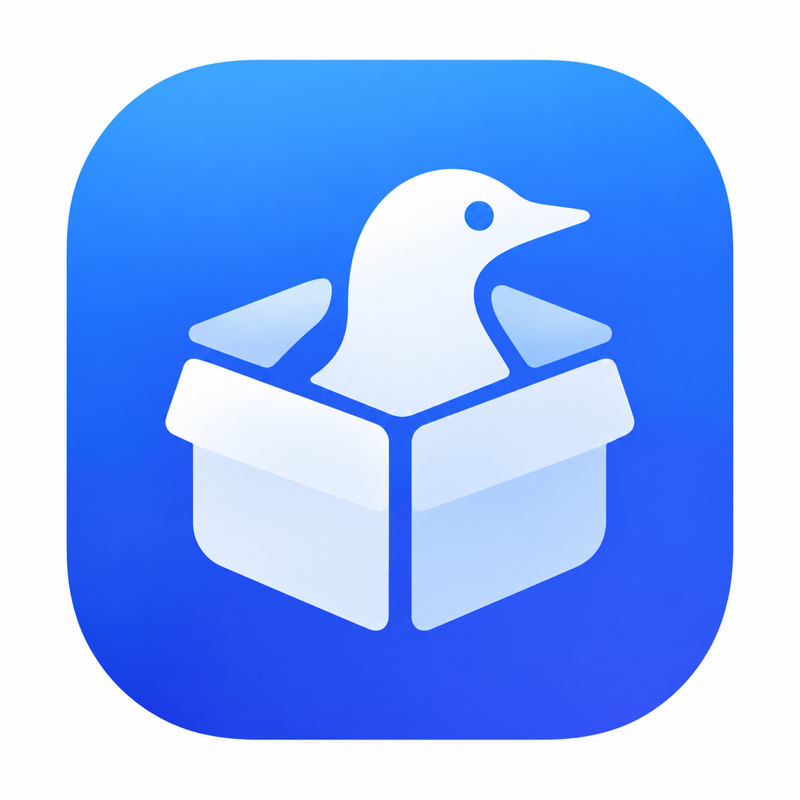

<a id="top"></a>

<div align="center">




<a href="https://www.nsloon.com/"></a>

[](LICENSE)
[](https://github.com/OliviaR13/MyLoon/commits/main)
[](plugin/)
[](https://olivia-loon-box.pages.dev/)

**[打开 Loon Box](https://olivia-loon-box.pages.dev/)**
·
[快速开始](#快速开始)
·
[插件分类](#插件分类)
·
[常见问题](#常见问题)
·
[反馈问题](https://github.com/OliviaR13/MyLoon/issues)

</div>

---

> [!CAUTION]
> 禁止在中华人民共和国境内宣传本仓库。请勿在境内社交媒体、论坛、群组、视频平台或其他公开渠道发布、转发或推广本仓库，以及其链接、截图与插件地址。

> [!IMPORTANT]
> - 仅供个人学习交流。插件、脚本与网页主要由 AI 辅助编写，不保证适用于所有网络环境与账号状态。使用前请自行审阅规则内容，并遵守相关 App 的用户协议。因使用本仓库内容导致的账号或网络问题，作者不承担责任。
> - 插件必须排在主配置的 `GEOIP,CN,DIRECT` 等国内直连规则之前，否则会被抢先命中而不生效。
> - 名称带「自选节点」的插件，须在插件详情页的「代理指向的策略」中手动选择策略组或节点。请优先使用固定的 `select` 节点，避免 `url-test` 等自动切换中断已建立的连接。
> - 带脚本的插件必须在 Loon 中安装并信任 MITM 证书，且开启 MITM。

<details>
<summary><b>目录</b></summary>

- [简介](#简介)
- [快速开始](#快速开始)
- [插件分类](#插件分类)
- [工作原理](#工作原理)
- [常见问题](#常见问题)
- [隐私](#隐私)
- [安装统计](#安装统计)
- [仓库结构](#仓库结构)
- [自动化](#自动化)
- [贡献](#贡献)
- [致谢](#致谢)
- [许可](#许可)

</details>

## 简介

MyLoon 是一组面向 Loon 的规则与脚本插件，覆盖三类场景：

| 🧭 代理分流 | 📍 属地控制 | 🔑 登录修复 |
|:---:|:---:|:---:|
| 指定服务的域名统一走代理 | 仅属地判定相关接口走代理 | 认证域名直连，必要时跳过 MITM |

仓库同时提供 **Loon Box**：部署于 Cloudflare Pages 的网页，支持检索、收藏插件，并通过 `loon://import` 一键唤起 Loon 安装。

## 快速开始

### Loon Box（推荐）

1. 用系统浏览器打开 [Loon Box](https://olivia-loon-box.pages.dev/)（微信内置浏览器无法唤起 Loon）。
2. 完成人机验证，找到插件后点击「安装」。
3. 可选：登录 GitHub，在多设备间同步收藏与界面偏好。

### 手动添加

在 Loon 中依次进入「插件」→ `+`，粘贴 raw 链接：

```text
https://raw.githubusercontent.com/OliviaR13/MyLoon/main/plugin/<文件名>.plugin
```

## 插件分类

插件头部的 `#!tag` 决定其在 Loon Box 中的分类，取第一个标签为主分类，多个标签以英文逗号分隔。

| 分类 | 说明 |
|---|---|
| 代理分流 | 指定 App 或服务的相关域名统一走 `PROXY` |
| IP 属地 | 仅属地判定相关接口走代理，媒体 CDN 直连 |
| 登录修复 | 认证相关域名直连，必要时跳过 MITM |
| 功能增强 | 通过脚本提供额外功能，通常作为次要标签 |

完整列表见 [Loon Box](https://olivia-loon-box.pages.dev/) 或 [`plugin/`](plugin/)。

## 工作原理

插件通过 `[Rule]` 为指定域名选择代理或直连，规则自上而下匹配，先命中者生效：

```text
请求 ├─ 命中插件规则 PROXY  → 使用所选策略组或节点
     ├─ 命中插件规则 DIRECT → 直连
     └─ 未命中              → 继续匹配主配置规则
```

「IP 属地」类插件只把承载属地与风控判定的少量接口送入代理，Feed、图片、视频等媒体 CDN 全部直连，不占用代理流量。

## 常见问题

<details>
<summary><b>插件已安装但未生效？</b></summary>

确认插件排在 `GEOIP,CN,DIRECT` 等国内直连规则之前；带脚本的插件还需开启 MITM。

</details>

<details>
<summary><b>同时启用多个 MITM 插件会冲突吗？</b></summary>

对相同域名做解密或响应体改写的插件各自独立生效，出现异常时需逐个排查。

</details>

<details>
<summary><b>连接偶尔失败是插件的问题吗？</b></summary>

插件只决定走代理还是直连。连接取消、重置或超时通常源于 App、节点、CDN 或链路，插件无法判断，也无法修复。

</details>

## 隐私

仅针对 Loon Box 网页：

- 不接入第三方统计分析，不追踪用户，不收集浏览记录。
- 点「安装」时，会给该插件的安装次数加一（只存插件 ID、日期和累计次数）。为了同一个人一天内不重复计数，会把 IP 与插件 ID 加盐哈希后临时保存，次日清理；不保存 IP 本身，也不与账号关联。
- 未登录时，收藏与偏好仅保存在本机浏览器。
- 登录仅通过 GitHub 授权读取公开资料（用户名、头像），不保存访问令牌；登录状态为 30 天有效的签名 Cookie。
- 登录后，收藏与已开启同步的偏好按账号 ID 存于 Cloudflare D1（没绑定 D1 时退回 KV），用于多设备同步。
- 人机验证由 Cloudflare Turnstile 提供。

## 安装统计

卡片上显示安装次数，排序菜单里有「本周热度」和「总安装量」。数据存在 Cloudflare D1，需要一次性配置：

<details>
<summary><b>配置步骤</b></summary>

1. Cloudflare 控制台 → Storage & Databases → D1 → 创建一个数据库（名称随意）。
2. Pages 项目 → Settings → Bindings → Add → D1 database，变量名填 `MLB_DB`，选刚创建的数据库。
3. 重新部署一次。表会在第一次访问时自动创建。
4. 推荐：在 Pages 项目 → Settings → Variables and Secrets 里新增一个 Secret：`INSTALL_HASH_SECRET`，填一段随机字符串，用作去重哈希的盐。不设时沿用 `TURNSTILE_SECRET`（再退一步是 `SESSION_SECRET`）；三个都没有时不记录统计，不会退回固定默认值。

</details>

同一个 D1 也用来存多设备同步的数据（收藏、设置）。多台设备同时提交时，每条收藏、每组设置各自按时间戳「较新者胜」，不会互相覆盖；没绑 D1 时同步退回 KV，并发时仍可能丢改动，所以推荐绑定。从 KV 升级不用手动操作，每个用户第一次同步时会自动迁移。

没有绑定 `MLB_DB` 时统计整体关闭：卡片不显示次数，排序菜单也不出现这两项，其余功能不受影响。次数统计的是「点了安装」，不代表 Loon 里最终安装成功。

## 仓库结构

| 路径 | 内容 |
|---|---|
| [`plugin/`](plugin/) | Loon 插件（11 款） |
| [`script/`](script/) | 插件所用脚本 |
| [`box/`](box/) | Loon Box 前端（原生 HTML / CSS / ES Modules） |
| [`functions/`](functions/) | Cloudflare Pages Functions：清单接口、GitHub OAuth、云端同步、人机验证、安装统计 |
| [`tests/`](tests/) | 云端同步的测试，含并发场景（`node --test tests/sync.test.mjs tests/sync-d1.test.mjs`） |
| [`db/`](db/) | 安装统计的 D1 表结构（函数会自动建表，仅供参考） |
| [`icon/`](icon/) | 图标资源 |
| [`manifest.json`](manifest.json) | 插件清单，由 Actions 自动生成，请勿手动编辑 |
| [`.github/workflows/`](.github/workflows/) | 清单生成工作流 |

## 自动化

向 `main` 推送 `plugin/*.plugin` 或工作流变更后，GitHub Actions 将：

1. 解析各插件头部元数据（`#!name`、`#!desc`、`#!tag`、`#!version` 等），并依据 `[MITM]`、`[Script]`、`[Argument]` 判定「需 MITM」「含脚本」「可配置」标签；
2. 重新生成 `manifest.json` 并提交回仓库；
3. 触发 Cloudflare Pages 重新部署。

无 `#!tag` 的插件按工作流中的文件名映射表归类，未收录的归入「其他」。

## 贡献

1. 将 `.plugin` 放入 `plugin/`，配套脚本放入 `script/`。
2. 填写头部元数据：

   ```text
   #!name = 示例 自选节点
   #!desc = 功能说明
   #!tag = 代理分流
   #!author = @OliviaR13
   #!icon = https://example.com/icon.png
   #!version = 1.0.0
   ```

3. 提交到 `main`，其余由 Actions 处理。

发现问题或有想法，欢迎提 [Issue](https://github.com/OliviaR13/MyLoon/issues)。

## 致谢

| 项目 | 用途 |
|---|---|
| [Loon 插件文档](https://nsloon.app/docs/Plugin/) | 插件头部字段、`[Argument]` 与 `#!tag` 写法 |
| [SunsetMkt/anti-ip-attribution](https://github.com/SunsetMkt/anti-ip-attribution) | 规则思路参考 |
| [Koolson/Qure](https://github.com/Koolson/Qure)、[luestr/IconResource](https://github.com/luestr/IconResource) | 插件图标 |
| [Cloudflare Pages](https://developers.cloudflare.com/pages/)、[Turnstile](https://developers.cloudflare.com/turnstile/) | 托管、接口与人机验证 |
| [Shields.io](https://shields.io/) | 顶部徽章 |
| [othneildrew/Best-README-Template](https://github.com/othneildrew/Best-README-Template)、[mrchief/awesome-readme](https://github.com/mrchief/awesome-readme) | README 排版参考 |
| [kyechan99/capsule-render](https://github.com/kyechan99/capsule-render)、[DenverCoder1/readme-typing-svg](https://github.com/DenverCoder1/readme-typing-svg) | 顶部 / 底部波浪横幅、打字动画 |

## 许可

版权所有 © 2026 soobsessed，保留所有权利，详见 [LICENSE](LICENSE)。

第三方内容：[`script/spotify/`](script/spotify/) 下的脚本源自 [app2smile/rules](https://github.com/app2smile/rules)，版权归原作者所有，按 MIT 许可使用，见 [script/spotify/LICENSE](script/spotify/LICENSE)。

<div align="center">

[↑ 回到顶部](#top)


</div>
